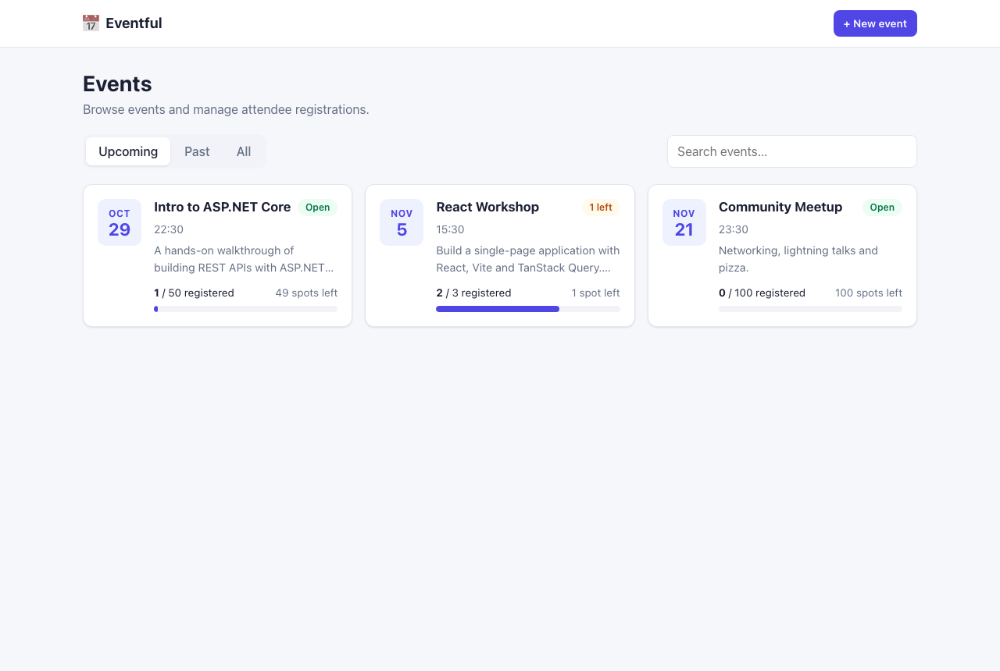
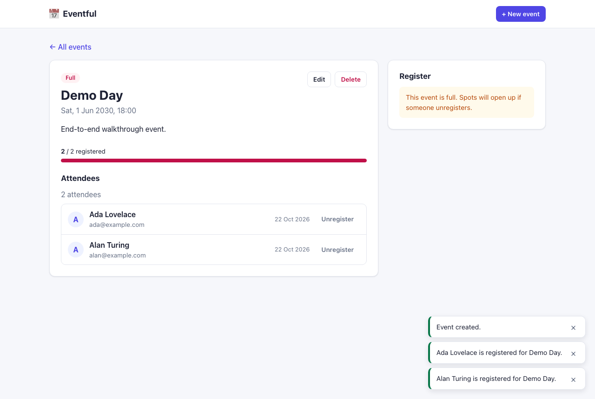

# Eventful — Event Management

[](https://github.com/vishalgupta2446/event-management/actions/workflows/ci.yml)


A full-stack app for managing events and attendee registrations: an ASP.NET Core REST API with tested business rules, and a React single-page app.

| Events list | Event detail and registration |
| --- | --- |
|  |  |

| Part     | Stack                                                         | Folder                   |
| -------- | ------------------------------------------------------------- | ------------------------ |
| Backend  | C# / ASP.NET Core Web API (.NET 10), in-memory storage, xUnit | [`backend/`](backend/)   |
| Frontend | React 19 + Vite + TypeScript, TanStack Query, React Router    | [`frontend/`](frontend/) |

## Features

- **Events**: create, view, edit and delete events (title, description, date, max capacity).
- **Registrations**: register attendees (name and email) and unregister them.
- **Business rules**, enforced on the server:
  - You can't register for an event that has already started or finished.
  - You can't register more people than the event's capacity.
  - You can't register the same person (email, ignoring case) twice for the same event.
- **UI**: tabs for upcoming, past and all events, search, capacity bars and status badges, client-side form validation, readable server error messages, pop-up notifications, and dark mode. It also works on small screens.

## Prerequisites

- [.NET SDK 10](https://dotnet.microsoft.com/download)
- [Node.js 20+](https://nodejs.org/) (with npm)

## Running locally

Open two terminals.

**1. Backend API** runs on http://localhost:5080:

```bash
cd backend
dotnet run --project src/EventManagement.Api
```

- Swagger UI: http://localhost:5080/swagger
- In Development, the API loads a few sample events at startup, including a past event and an almost-full one. To turn this off, set `"SeedSampleData": false` in `appsettings.Development.json`.
- The data is kept in memory, so it's reset every time the API restarts.

**2. Frontend** runs on http://localhost:5173:

```bash
cd frontend
npm install
npm run dev
```

Open http://localhost:5173. The Vite dev server forwards `/api/*` requests to the backend, so no CORS setup is needed. If the backend runs somewhere else, start the dev server with `API_PROXY_TARGET=http://host:port npm run dev`. For a production build served from a different origin, set `VITE_API_BASE_URL` (see `frontend/.env.example`) and add that origin to `Cors:AllowedOrigins` in the API config.

### Running the tests

```bash
cd backend
dotnet test
```

- `EventServiceTests` are **unit tests** for all of the business logic: capacity, duplicates, past events, updates and deletes. They include a test that sends many registrations in parallel and checks capacity is never exceeded. They use `FakeTimeProvider` to control the clock, so the date rules are tested reliably.
- `EventsApiTests` are **integration tests** using `WebApplicationFactory`. They check routing, input validation, status codes and the shape of error responses.

Frontend checks: `npm run lint` and `npm run build` (which includes the TypeScript type check).

### Trying the API without the UI

- Swagger UI at `/swagger`.
- `backend/src/EventManagement.Api/EventManagement.Api.http` has ready-to-run requests for the VS Code REST Client, JetBrains or Visual Studio.

## API reference

Base URL: `http://localhost:5080/api`

| Method | Path                                       | Description                                | Success | Errors        |
| ------ | ------------------------------------------ | ------------------------------------------ | ------- | ------------- |
| GET    | `/events?status=all\|upcoming\|past`       | List events (sorted by date)               | 200     |               |
| GET    | `/events/{id}`                             | Get one event                              | 200     | 404           |
| POST   | `/events`                                  | Create an event                            | 201     | 400           |
| PUT    | `/events/{id}`                             | Update an event (replaces all fields)      | 200     | 400, 404, 409 |
| DELETE | `/events/{id}`                             | Delete an event and its registrations      | 204     | 404           |
| GET    | `/events/{id}/registrations`               | List an event's attendees                  | 200     | 404           |
| POST   | `/events/{id}/registrations`               | Register an attendee `{ name, email }`     | 201     | 400, 404, 409 |
| DELETE | `/events/{id}/registrations/{regId}`       | Unregister                                 | 204     | 404, 409      |

Event payload:

```json
{ "title": "Team Offsite", "description": "Optional", "date": "2030-06-01T09:00:00Z", "maxCapacity": 25 }
```

Event responses also include computed fields (`registeredCount`, `remainingCapacity`, `isFull`, `isPast`), so the list page never needs to fetch each event's registrations.

All errors use the standard [RFC 9457 problem details](https://www.rfc-editor.org/rfc/rfc9457) format. Business-rule errors add a `code` field that clients can check:

| Code                           | Status | Meaning                                         |
| ------------------------------ | ------ | ----------------------------------------------- |
| `event_not_found`              | 404    | No event with this id                           |
| `registration_not_found`       | 404    | No registration with this id for this event     |
| `event_date_in_past`           | 400    | The event date must be in the future            |
| `event_full`                   | 409    | The event is at capacity                        |
| `already_registered`           | 409    | This email is already registered for the event  |
| `event_in_past`                | 409    | The event has already happened (registration closed, or it can't be edited) |
| `capacity_below_registrations` | 409    | Capacity can't be set below the number already registered |

## Project structure

```
backend/
  src/EventManagement.Api/
    Controllers/    HTTP layer only: turns requests into service calls and results into responses
    Services/       EventService (all business rules), EventErrors
    Repositories/   IEventRepository + thread-safe in-memory implementation
    Models/         Event and Registration domain objects
    Contracts/      Request/response types with validation attributes
    Common/         Result/Error types and the mapping from errors to problem details
    Data/           Sample data loaded at startup
  tests/EventManagement.Tests/
frontend/
  src/
    api/            fetch client (ApiError), endpoint functions, TanStack Query hooks
    components/     EventCard, EventForm, registration form and attendee list, toasts, ...
    pages/          Events list, event detail, create/edit, not found
    lib/            Date formatting helpers
```

## Design decisions

- **The service holds all the business rules.** Controllers stay thin. Expected failures (not found, full, duplicate) come back as a `Result` with an `Error`, and are then turned into a 400, 404 or 409 response. Exceptions are only used for real bugs.
- **Concurrent requests are handled safely.** Checking for a free seat and taking it happen under one lock, so two requests at the same moment can't both take the last seat (there's a test for this). One lock is the simplest correct choice for an in-memory store. With a database, this would become a transaction or an optimistic concurrency check.
- **The clock can be replaced in tests.** `TimeProvider` is injected, so "past event" logic can be tested reliably with `FakeTimeProvider`.
- **The storage layer is behind an interface.** `IEventRepository` could be swapped for a database implementation without changing the business logic.
- **An attendee is identified by email**, because authentication is out of scope. Emails are trimmed and compared ignoring case.
- **Extra rules I added beyond the brief:**
  - New or updated events must be in the future.
  - Past events are read-only: they can't be edited, and attendees can't be removed from them.
  - Capacity can't be set below the number of people already registered.
  - An event counts as "past" from its start time onward.
- **Frontend data handling.** TanStack Query caches responses (data stays fresh for 30 seconds) and avoids duplicate requests. After a create, update, delete, register or unregister, only the affected queries are refreshed. The detail page first shows the copy of the event already loaded on the list page, then replaces it with fresh data. If a registration fails because the cached counts were out of date (for example, the event filled up in the meantime), the app re-fetches them.
- **Out of scope**: authentication, saving data to a database, and paging the event list.
